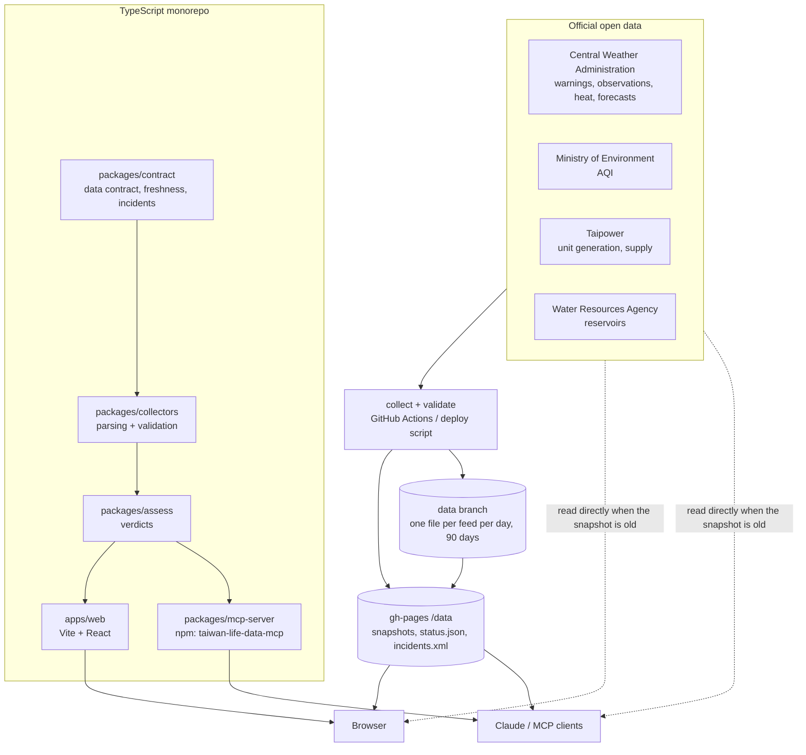

# taiwan-life-data (台灣生活資料誌)

[繁體中文](README.md) ・ **English**

Pick any of Taiwan's 368 townships and one card answers *"what should I watch out for when I go out today?"* — weather warnings → heat injury / UV → air quality → rain. Every item shows the **official data time**; when data is stale or missing the site draws **no conclusion** (fail-closed).

Also: **Taiwan today** (grid carbon intensity, the lowest-carbon hours, 20 main reservoirs), an automatically generated **status and incident page**, and everything published as an **open JSON API**, a **90-day history archive** and an **MCP server**.

- Live site: <https://livejiaquan.github.io/taiwan-life-data/>
- Taiwan today: <https://livejiaquan.github.io/taiwan-life-data/today/>
- Data status and incidents: <https://livejiaquan.github.io/taiwan-life-data/status/> ([Atom feed](https://livejiaquan.github.io/taiwan-life-data/data/incidents.xml))

| Before you go out (Annan, Tainan) | Taiwan today | Data status |
|---|---|---|
|  |  |  |

Screenshots are the real live site (2026-10-16 02:28 Taipei time, 390 px mobile emulation), not mock-ups. The interface is in Traditional Chinese.

## Use it from Claude (MCP server)

```sh
claude mcp add taiwan-life-data -- npx -y taiwan-life-data-mcp
# until the npm release is out, the same build from GitHub Releases:
claude mcp add taiwan-life-data -- npx -y --package=https://github.com/livejiaquan/taiwan-life-data/releases/download/mcp-v0.1.0/taiwan-life-data-mcp-0.1.0.tgz taiwan-life-data-mcp
```

Then ask things like "What should I watch out for in Annan District, Tainan today?", "How carbon-intensive is Taiwan's grid right now?" or "How full is Zengwen Reservoir?". Tools: `outdoor_brief`, `list_towns`, `grid_carbon`, `reservoirs`, `data_status`, `history`. Each answer carries the data time and status, and gives no verdict on stale data. Details: [`packages/mcp-server`](packages/mcp-server/README.md).

## Open JSON API

Static JSON, no key, `Access-Control-Allow-Origin: *`:

```sh
curl -s https://livejiaquan.github.io/taiwan-life-data/data/catalog.json      # machine-readable catalogue
curl -s https://livejiaquan.github.io/taiwan-life-data/data/power.json        # grid carbon intensity
curl -s https://livejiaquan.github.io/taiwan-life-data/archive/v1/index.json  # 90-day archive index
```

Every file uses one envelope: `sourceTime` (official data time), `retrievedAt`, `status` (`live|delayed|stale|unavailable` — **recompute it at read time** with the documented thresholds), `source` (agency, dataset, licence), `issues`, `data`. Full reference (in Chinese, with code samples): [`docs/API.md`](docs/API.md). Carbon method and factor sources: [`docs/METHODOLOGY-carbon.md`](docs/METHODOLOGY-carbon.md).

## Architecture



- **One data contract**: every feed has `sourceTime` / `retrievedAt` / `status` / `source`; status is always recomputed from data age at display time.
- **One set of verdicts**: the website and the MCP server share `packages/assess`, so the same data gives the same answer.
- **No keys in the browser**: the public build scans its output and fails on credential markers or key-bearing URLs.
- **No database**: status and incidents are read back from the live site and appended; the archive is the repo's `data` branch.
- **Automatic incident log**: each collect run flags *collect failed*, *stale at collect time* and *collector gap* (more than 1 hour between runs), and closes incidents on recovery — published on `/status`, as an [Atom feed](https://livejiaquan.github.io/taiwan-life-data/data/incidents.xml) and in `archive/v1/incidents.json` (90 days).

Design decisions with measurements: [`docs/DECISIONS.md`](docs/DECISIONS.md) (Chinese).

## Data sources and licences

| Feed | Agency | Dataset | Official cadence |
|---|---|---|---|
| Weather warnings | Central Weather Administration (CWA) | W-C0033-001 ([data.gov.tw 9244](https://data.gov.tw/dataset/9244)) | on issue / cancel |
| UV and temperature | CWA | O-A0003-001 ([9178](https://data.gov.tw/dataset/9178)) | every 10 min |
| Heat-injury index (368 townships) | CWA | M-A0085-001 ([143330](https://data.gov.tw/dataset/143330)) | every 6 h |
| 3-hour rain probability (368 townships) | CWA | F-D0047-001…085 | 4× a day |
| Air quality index | Ministry of Environment | AQX_P_432 ([40448](https://data.gov.tw/dataset/40448)) | hourly |
| Grid carbon intensity, fuel mix | Taiwan Power Company | unit generation ([8931](https://data.gov.tw/dataset/8931)), supply and demand ([162595](https://data.gov.tw/dataset/162595)) | every 10 min |
| Reservoir storage (20) | Water Resources Agency | [45501](https://data.gov.tw/dataset/45501), [41568](https://data.gov.tw/dataset/41568) | hourly (some daily) |

- **Data**: provided under the [Open Government Data License, version 1.0](https://data.gov.tw/license) (政府資料開放授權條款－第 1 版); attribution to each agency is kept in every file. This project is not affiliated with any agency — for warnings and disaster information, the official releases prevail.
- **Carbon factors**: lifecycle factors (IPCC 2014 et al.) as compiled in Electricity Maps' `defaults.yaml` (MIT); per-factor sources in the methodology doc.
- **Code**: [MIT](LICENSE).

## Development

```sh
npm install
npm test               # offline fixture tests
npm run collect        # fetch official data into apps/web/public/data/
npm run dev
npm run build:public   # production build + credential scan
npm run build:mcp      # bundle the MCP server (packages/mcp-server/dist)
```
