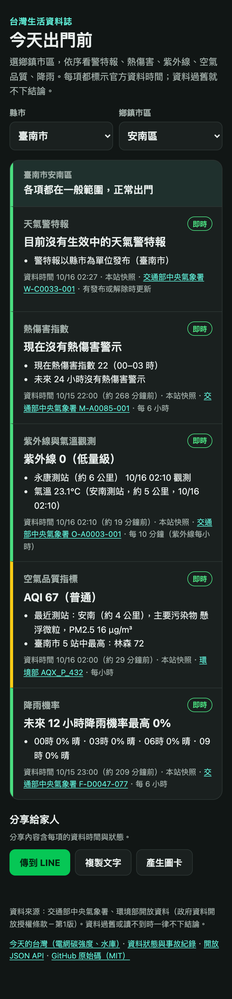
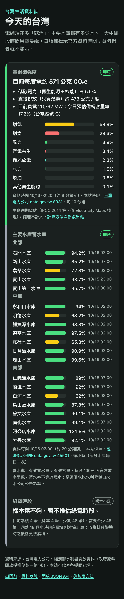
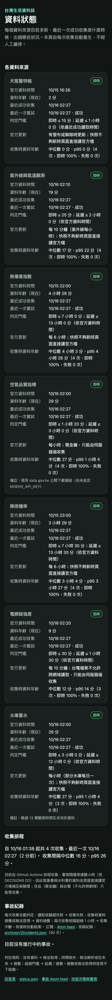
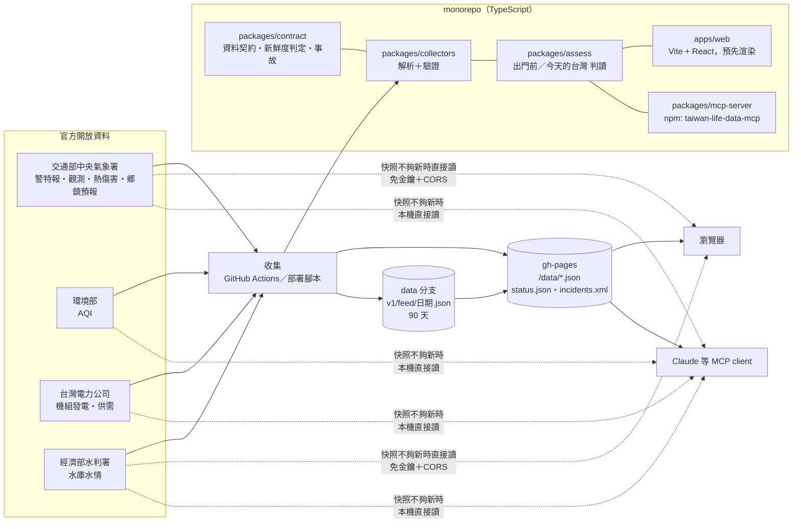

# 台灣生活資料誌（taiwan-life-data）

**繁體中文** ・ [English](README.en.md)

選鄉鎮市區（全台 368 個），一張卡回答「今天出門要注意什麼」：天氣警特報 → 熱傷害／紫外線 → 空氣品質 → 降雨。每一項都標示**官方資料時間**；資料過舊或讀不到時一律不下結論（fail-closed）。

另有「今天的台灣」（電網碳強度、綠電時段、20 座主要水庫）、自動產生的資料狀態與事故紀錄頁，所有資料都以**開放 JSON API**、**90 天歷史存檔**與 **MCP server** 公開。

- 線上版：<https://livejiaquan.github.io/taiwan-life-data/>
- 今天的台灣：<https://livejiaquan.github.io/taiwan-life-data/today/>
- 資料狀態與事故紀錄：<https://livejiaquan.github.io/taiwan-life-data/status/>（[Atom 訂閱](https://livejiaquan.github.io/taiwan-life-data/data/incidents.xml)）

| 出門前（臺南市安南區） | 今天的台灣 | 資料狀態 |
|---|---|---|
|  |  |  |

截圖為線上網站實際畫面（2026-10-16 02:28 台北時間，手機 390 px 寬模擬），不是設計稿。

## 在 Claude 裡用（MCP server）

```sh
claude mcp add taiwan-life-data -- npx -y taiwan-life-data-mcp
# npm 尚未發佈前，用 GitHub Release 的同一份建置：
claude mcp add taiwan-life-data -- npx -y --package=https://github.com/livejiaquan/taiwan-life-data/releases/download/mcp-v0.1.0/taiwan-life-data-mcp-0.1.0.tgz taiwan-life-data-mcp
```

然後直接問「臺南市安南區今天出門要注意什麼？」「現在台灣的電每度排多少碳？」「曾文水庫還有多少水？」。工具：`outdoor_brief`、`list_towns`、`grid_carbon`、`reservoirs`、`data_status`、`history`；每個回答都附資料時間與狀態，過舊就不下結論。說明見 [`packages/mcp-server`](packages/mcp-server/README.md)。

## 開放 JSON API

免金鑰、`Access-Control-Allow-Origin: *` 的靜態 JSON：

```sh
curl -s https://livejiaquan.github.io/taiwan-life-data/data/catalog.json   # 機器可讀目錄
curl -s https://livejiaquan.github.io/taiwan-life-data/data/power.json     # 電網碳強度
curl -s https://livejiaquan.github.io/taiwan-life-data/archive/v1/index.json  # 90 天存檔索引
```

每個檔案都是同一個信封格式：`sourceTime`（官方資料時間）、`retrievedAt`、`status`（`live|delayed|stale|unavailable`，**讀取時請用文件中的門檻重算**）、`source`（機關、資料集、授權）、`issues`、`data`。完整說明：[`docs/API.md`](docs/API.md)；碳強度方法與係數出處：[`docs/METHODOLOGY-carbon.md`](docs/METHODOLOGY-carbon.md)。

## 架構



- **一個資料契約**：每個 feed 都有 `sourceTime`／`retrievedAt`／`status`／`source`；狀態一律在顯示當下依資料年齡重算，過舊不下結論。
- **同一套判讀**：網站與 MCP server 共用 `packages/assess`，同一筆資料得到同一個結論。
- **金鑰不進瀏覽器**：公開建置會掃描產物，出現金鑰字樣或需金鑰的網址就失敗（`scripts/build-public.ts`）。
- **沒有資料庫**：狀態與事故從線上讀回上一份再累積；歷史存檔是 repo 的 `data` 分支。
- **自動事故紀錄**：每次收集判定「收集失敗／資料過舊／收集中斷（兩次收集相隔超過 1 小時）」，恢復時自動結案；`/status` 頁、[Atom feed](https://livejiaquan.github.io/taiwan-life-data/data/incidents.xml)、`archive/v1/incidents.json`（90 天）三處公開。

技術決策與實測數據：[`docs/DECISIONS.md`](docs/DECISIONS.md)；計畫與進度：[`docs/PLAN.md`](docs/PLAN.md)、[`docs/PROGRESS.md`](docs/PROGRESS.md)。

## 資料來源與授權

| Feed | 機關 | 資料集 | 官方更新 | 取得方式 |
|---|---|---|---|---|
| 天氣警特報 | 交通部中央氣象署 | W-C0033-001（[data.gov.tw 9244](https://data.gov.tw/dataset/9244)） | 有發布／解除時 | 瀏覽器直接讀官方公開檔（快照備援） |
| 紫外線與氣溫觀測 | 交通部中央氣象署 | O-A0003-001（[9178](https://data.gov.tw/dataset/9178)） | 每 10 分鐘 | 同上 |
| 熱傷害指數（368 鄉鎮） | 交通部中央氣象署 | M-A0085-001（[143330](https://data.gov.tw/dataset/143330)） | 每 6 小時 | 同上 |
| 3 小時降雨機率（368 鄉鎮） | 交通部中央氣象署 | F-D0047-001～085 | 一天 4 次 | 快照；不夠新時只讀所選縣市那一檔 |
| 空氣品質指標 | 環境部 | AQX_P_432（[40448](https://data.gov.tw/dataset/40448)） | 每小時 | 伺服器端收集（需金鑰，金鑰不進瀏覽器） |
| 電網碳強度、能源別發電 | 台灣電力公司 | 各機組發電量即時資訊（[8931](https://data.gov.tw/dataset/8931)）、今日系統供需狀況（[162595](https://data.gov.tw/dataset/162595)） | 每 10 分鐘 | 伺服器端收集（官方檔不允許跨網域） |
| 水庫蓄水率（20 座） | 經濟部水利署 | 水庫水情資料（[45501](https://data.gov.tw/dataset/45501)）、水庫每日營運狀況（[41568](https://data.gov.tw/dataset/41568)） | 每小時（部分每日） | 快照；不夠新時瀏覽器直接讀官方 API |

- **資料授權**：以上資料皆依[政府資料開放授權條款－第 1 版](https://data.gov.tw/license)提供；本站與 API 轉載時保留各機關名稱與資料集。本站不代表任何機關立場，警特報與防災資訊請以官方發布為準。
- **碳強度係數**：IPCC 2014 等生命週期係數，依 Electricity Maps `defaults.yaml`（MIT）取值，逐項出處見方法文件。
- **程式碼**：[MIT](LICENSE)。

## 開發

```sh
npm install
npm test               # 離線 fixture 測試（lint、typecheck 另見 package.json）
npm run collect        # 抓官方資料寫入 apps/web/public/data/
npm run archive -- archive-data   # 併入存檔（archive-data 為 data 分支的 checkout）
npm run dev
npm run build:public   # 正式建置＋金鑰掃描
npm run build:mcp      # 打包 MCP server（packages/mcp-server/dist）
npm run probe          # 重新實測各端點 CORS／延遲
```
